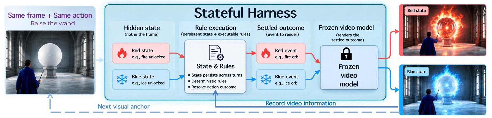
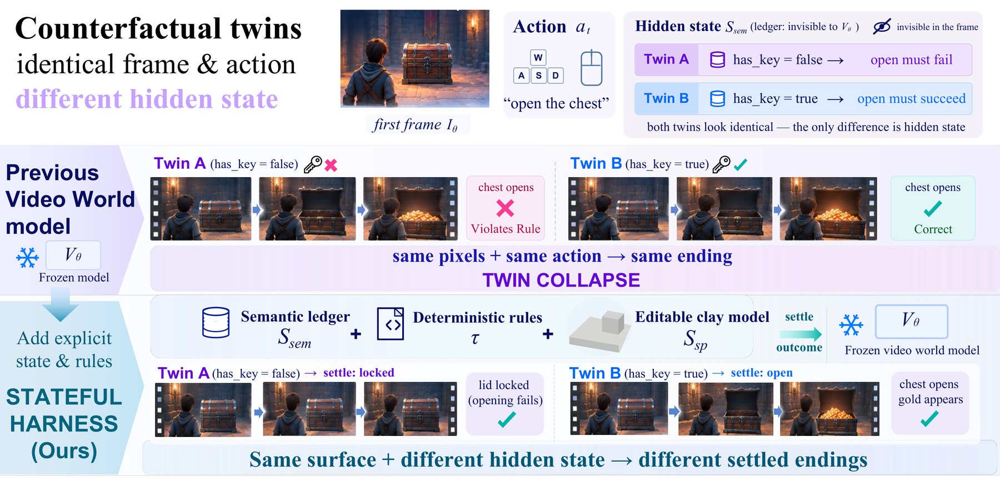
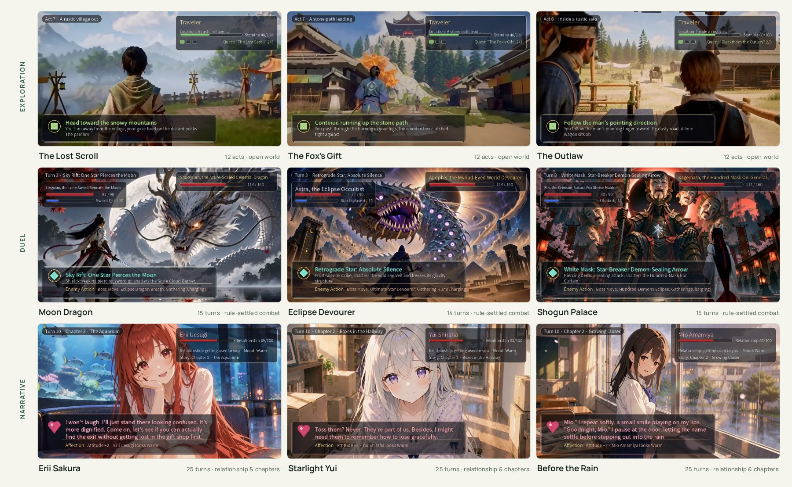

<div align="center">

# State World Models: Execute the Rules, Generate the Pixels

[Chan Yan Ki](https://github.com/yankeee-0411)<sup>1,\*</sup>,
[Yanran Zhang](https://yanran-zhang.github.io/)<sup>1,\*</sup>,
[Wenzhao Zheng](https://wzzheng.net/)<sup>1,†</sup>,
[Xiaofeng Wang](https://github.com/JeffWang987)<sup>1</sup>,
[Zheng Zhu](https://www.zhengzhu.net/)<sup>2</sup>,
[Lei Chen](https://scholar.google.com/citations?user=8bMh-FQAAAAJ)<sup>1</sup>,
[Jie Zhou](https://scholar.google.com/citations?user=6a79aPwAAAAJ)<sup>1</sup>,
[Jiwen Lu](https://scholar.google.com/citations?user=TN8uDQoAAAAJ)<sup>1</sup>

<sup>1</sup>[Tsinghua University](https://www.tsinghua.edu.cn/) &nbsp;&nbsp; <sup>2</sup>[GigaAI](https://gigaai.cc/)

<sup>\*</sup>Equal contribution &nbsp;&nbsp; <sup>†</sup>Project leader

[](https://ivg-yanranzhang.github.io/StateWorldModel/)
[](https://ivg-yanranzhang.github.io/StateWorldModel/static/pdfs/state-world-models.pdf)
[](http://arxiv.org/abs/2610.26811)
[](https://ivg-yanranzhang.github.io/StateWorldModel/static/videos/state-world-models-v7.mp4)
[](https://huggingface.co/datasets/Louis0411/StateWorldModel)
[](https://modelscope.cn/datasets/Louis0411/StateWorldModel/)
[](#license)

</div>

<p align="center">
  
</p>

**TL;DR.** **Stateful Harness** keeps an explicit world state, executes the game's rules on it *before* generation, and has a **frozen** video model render only the settled outcome; the last frame anchors the next turn.
**WorldState-Bench** tests this with 50 counterfactual twin pairs that share a first frame and an action but differ in one hidden value.
With the same frozen MiniMax-H3 weights, PairFollow rises from 32% (Rule-only prompt) to **92%**, and PairStrict from 4% to **90%**.

https://github.com/user-attachments/assets/3350534b-7e7c-4b82-b699-7d5111f32ab0

<p align="center">
  <sub>Autoplaying preview of the project film. Click it for the full 2:59 film with sound.</sub>
</p>
<!-- GitHub video player: edit this file on github.com and drag assets/StateWorldModels_demo_v7_github_10MB.mp4
     onto the next line; GitHub uploads it and inserts a https://github.com/user-attachments/assets/… link,
     which renders as an inline player (repository files, raw URLs and <video> tags are not rendered). -->

## Contents

- [Overview](#overview)
- [Installation](#installation)
- [Models and data](#models-and-data)
- [Quick start](#quick-start)
- [Building games](#building-games)
- [WorldState-Bench](#worldstate-bench)
- [MiniMax-H3 runtime and spatial preview](#minimax-h3-runtime-and-spatial-preview)
- [Reproducing the paper](#reproducing-the-paper)
- [Repository structure](#repository-structure)
- [Results](#results)
- [Citation](#citation) · [Acknowledgements](#acknowledgements) · [License](#license)

## News

- **2026-10** — Code, the WorldState-Bench dataset ([Hugging Face](https://huggingface.co/datasets/Louis0411/StateWorldModel) · [ModelScope](https://modelscope.cn/datasets/Louis0411/StateWorldModel/)) and the [project page](https://ivg-yanranzhang.github.io/StateWorldModel/) are released.

## Overview

| Directory | Contents | Docs |
|---|---|---|
| [`agentic_game/`](agentic_game) | **Stateful Harness**: turn-based runtime, 20 games as JSON skins, renderer/LLM services, Gradio UI, harness-side benchmark evaluation | [README](agentic_game/README.md) · [AGENTS.md](agentic_game/AGENTS.md) |
| [`worldstate_bench/`](worldstate_bench) | **WorldState-Bench**: dataset generation, VLM judge and metrics, baseline wrappers | [README](worldstate_bench/README.md) · [USAGE.md](worldstate_bench/USAGE.md) |
| [`h3-a800/`](h3-a800) | Frozen **MiniMax-H3** renderer (T2V / I2V / Ref2VA) for 4 or 8 A800-80GB GPUs | [README](h3-a800/README.md) · [DESIGN.md](h3-a800/DESIGN.md) |
| [`spatial_proxy/`](spatial_proxy) | `box2clay` spatial preview for the external WBench evaluation | [README](spatial_proxy/README.md) |

Game logic, the offline demo and all unit tests run on CPU; real rendering needs 4 or 8 GPUs with 80 GB each (we used one 8×A800 node).

## Installation

```bash
git clone https://github.com/Zhangyr2022/StateWorldModel.git && cd StateWorldModel

# base environment (Python ≥ 3.11, CPU): game runtime, UI, benchmark tooling
pip install -r agentic_game/requirements.txt -r worldstate_bench/requirements.txt

# GPU environment for MiniMax-H3 and the resident renderer / Qwen services
conda create -n h3-a800 python=3.12 -y && conda activate h3-a800
pip install -r h3-a800/requirements.txt      # pins torch 2.10.0+cu130 / torchvision 0.25.0+cu130 (CUDA 13 index)
```

| Environment | Used for |
|---|---|
| base (Python ≥ 3.11) | game runtime, Gradio UI, benchmark data and metrics, CPU tests |
| `h3-a800` (Python 3.12) | MiniMax-H3 rendering and the resident renderer / Qwen services; tested with PyTorch 2.10.0+cu130, Triton 3.6.0, transformers 5.8.1, CUDA 13 |
| `flux2`, `kairos` | regenerating the benchmark and its standalone judge: `bash worldstate_bench/generation/ops/envs/rebuild_envs.sh <conda-prefix>` |
| `bpy311`, `wilddet3d` | spatial preview only ([setup](spatial_proxy/README.md#installation)) |

The resident services find the GPU environment by name: workers run `$CONDA_ENVS_ROOT/h3-a800/bin/python` (default `CONDA_ENVS_ROOT=~/miniconda3/envs`) and the first `torchrun` on `PATH`. If you name the environment differently, or another PyTorch install is on `PATH`, set `AGENTIC_GAME_TORCHRUN=<env>/bin/torchrun` and `AGENTIC_GAME_QWEN_PYTHON=<env>/bin/python` (or `CONDA_ENVS_ROOT`) explicitly. Cross-project paths are derived from the side-by-side layout; override them with `WORKSPACE_ROOT`.
Behind a slow network, use `pip -i https://pypi.tuna.tsinghua.edu.cn/simple` and `HF_ENDPOINT=https://hf-mirror.com`.

## Models and data

No third-party libraries, weights or data are stored in git. Download what you need:

| Asset | Needed for | Command / location |
|---|---|---|
| Game first frames (~94 MB) | games and `agentic_game` tests | `cd agentic_game && python download_assets.py` |
| WorldState-Bench (~63 MB) | benchmark evaluation | `cd worldstate_bench && python download_data.py` → `data/cases/` |
| [MiniMax-H3](https://huggingface.co/MiniMaxAI/MiniMax-H3) (~210 GB, MiniMax H3 Community License) | all rendering | `cd h3-a800 && python download_checkpoints.py --output-dir ./checkpoints --task both` (needs ~230 GB free; the script checks first) |
| [FastH3 4-step LoRA](https://huggingface.co/FastVideo/FastVideo-FastH3-4-step-Preview-v1-LoRA) (1.4 / 5.0 GB) | fast T2V / I2V (default) | included in `download_checkpoints.py` |
| [Minimax-h3-Turbo ref2v LoRA](https://huggingface.co/lightx2v/Minimax-h3-Turbo) (1.3 GB) | `--task ref2va` | included in `download_checkpoints.py` |
| Sol-Attn kernel ([NVlabs/Sana](https://github.com/NVlabs/Sana), `sol-engine`) | `--attention-backend sol` only | `cd h3-a800 && bash fetch_sol_attn.sh` (pinned commit + one patch) |
| [Qwen3.8-27B](https://huggingface.co/Qwen/Qwen3.8-27B) (~52 GB) | dialogue, open-world director, judge | `bash worldstate_bench/generation/ops/dl_qwen38.sh ~/models/Qwen3.8-27` |
| [FLUX.2-dev](https://huggingface.co/black-forest-labs/FLUX.2-dev) (gated) | regenerating the benchmark only | path in `worldstate_bench/config.yaml` |
| [WildDet3D](https://github.com/allenai/WildDet3D) (~4.7 GB) | third-person spatial preview only | clone into `spatial_proxy/WildDet3D/`, checkpoint in `WildDet3D/ckpt/` ([details](spatial_proxy/README.md#checkpoints)) |
| [WBench](https://huggingface.co/datasets/meituan-longcat/WBench) (third party) | Tables 2 and 8 only | set `WBENCH_ROOT` / `WBENCH_DATA` |

The two download scripts read from `Louis0411/StateWorldModel` (override with `--repo`; a [ModelScope mirror](https://modelscope.cn/datasets/Louis0411/StateWorldModel/) is available). Once weights are local, the H3 runtime runs with `HF_HUB_OFFLINE=1`. Keep the directory names under `h3-a800/checkpoints/` unchanged:

```text
h3-a800/checkpoints/
├── MiniMax-H3/
├── FastH3-4-step-Preview-v1-LoRA/{dense-datafree,vsa-datafree}/adapter_model.safetensors
└── Minimax-h3-Turbo/minimax_h3_ref2v_turbo_4step_v0.1_bf16.safetensors
```

## Quick start

**1. CPU-only check** (no GPU, no weights). The `fake` renderer runs the real rules and replaces only the pixels.

```bash
cd agentic_game
python download_assets.py
python3 -m unittest discover -s tests
python3 run_demo.py --game duel_oracle_machine_epic --renderer fake --agent auto --turns 3
```

**2. Play in the browser.** Pick a game in the lobby, choose the backend and seed, and press **Start Game**. Each turn you choose an action; the outcome is settled first, then rendered, and at the end **Generate full replay** stitches the episode into one captioned film. Duels play offline; story and open-world games need the Qwen service. Use `--host 0.0.0.0` to serve the LAN or `--share` for a temporary public link.

```bash
python3 run_ui.py --renderer fake          # http://127.0.0.1:7860
```

**3. Real rendering.** By default Qwen uses one GPU and MiniMax-H3 four (loading takes ~2 and ~6 min; a turn takes 16–40 s at 480p). Change the slots with `QWEN_GPU=0 H3_GPUS=1,2,3,4`.

```bash
cp config.example.toml config.toml                                # local settings, gitignored
QWEN_MODEL=~/models/Qwen3.8-27 scripts/start_services.sh start   # status | stop | restart
python3 run_ui.py --renderer h3 --mode remote
```

Settings resolve as built-in defaults ← `config.toml` ← environment variables (`AGENTIC_GAME_RENDERER`, `AGENTIC_GAME_SEED`, `AGENTIC_GAME_MAX_TURNS`, `AGENTIC_GAME_QWEN_MODEL`, …).

**4. Headless episodes.** `--seed` makes a trajectory reproducible, `--agent cli` lets you type actions, `--script a,b,c` fixes the scripted actions, `--res 480p|768p` sets the resolution, and open-world scenes are `western`, `anime`, `chinese`, `japan`, `roman` and `gta`.

```bash
python3 run_demo.py --game duel_moon_dragon_swordsman --renderer h3 --mode remote --agent random
python3 run_demo.py --game openworld --scene western --renderer h3 --mode remote --turns 12
python3 run_demo.py --game before_rain_mio_en --renderer h3 --mode remote
```

Each run writes `agentic_game/generated/run-<timestamp>/`: `turn_log.jsonl` (settlement, render request and captions per turn), one clip per turn, and `game_montage.mp4` with state captions (`--no-montage` skips it). `python3 scripts/rebuild_replay_hud.py <run_dir>` re-renders the HUD replay.

## Building games

| Category | Games | The player | How a turn is settled |
|---|---|---|---|
| Duel | 9 | clicks a skill | state machine + weighted boss table, fully deterministic |
| Story | 10 (EN / 中文) | types free-form dialogue | an LLM plays the character; relationship and mood advance chapters under clamped rules |
| Open world | 6 scenes | picks or writes an action | a VLM director advances the quest; stamina and quest state follow the rules |

Game ids are the file names in [`game/skins/`](agentic_game/game/skins) (e.g. `duel_shogun_mask_palace_epic`, `starlight_sister_yui_en`) plus `openworld`.

- **New world, no code:** add one JSON skin to `agentic_game/game/skins/`. It declares states, transitions, numeric rules and visual prompts, and is validated when the registry loads.
- **New mechanic:** implement the `GameRuntime` protocol in five small files under `agentic_game/game/<your_game>/` and register it in `game/registry.py`.

Both routes and the engine rules (deterministic `resolve_turn`, no prompt strings in game code, render failures never roll back state) are specified in [`AGENTS.md`](agentic_game/AGENTS.md).

## WorldState-Bench

<p align="center">
  
</p>

Twins A and B share the first frame, the action and the rule program, and differ only in a hidden value; a pair passes only if each clip shows its own required ending and never the other's. The 50 pairs cover 21 themes, with FLUX.2 first frames (1280×720) and gold endings simulated from a rule DSL. Clips are judged by Qwen3.8-27B with fixed-choice questions. Two probes are used: **Rule-only** (`raw`) and **Rule+end** (`raw_state`, which adds the required final state).

| Metric | Level | Passes when |
|---|---|---|
| **EndFollow** | clip | the final frames show this twin's required ending |
| **CntAbsent** | clip | the other twin's ending never appears |
| **Strict** | clip | EndFollow ∧ CntAbsent |
| **PairFollow** / **PairStrict** | pair | both twins pass EndFollow / Strict |
| **TwinContrast** | pair | the two judged endings differ |

Unclear answers count as wrong. The judge sees the branch-specific expected endings, never the hidden value, the rule or the other twin's ending.

<details>
<summary>Dataset layout</summary>

```text
worldstate_bench/data/cases/B01/
├── input.png      # shared first frame
├── case_A.json    # twin A: instruction, hidden_state, rule, gold_end_state, judge questions
├── case_B.json    # twin B
└── card_A.txt, card_B.txt   # human-readable cards
```

Field schema: [`worldstate_bench/README.md`](worldstate_bench/README.md#dataset-layout).

</details>

**Evaluate Stateful Harness** (Table 1, our row). Table 1 uses the `--ref2va` setting: the shared first frame is passed to MiniMax-H3 Ref2VA as an image reference, with the Minimax-h3-Turbo ref2v LoRA, on all 8 GPUs. Free the GPUs, then run all stages; the command starts the Ref2VA service when it is not running, renders the 100 clips and judges them with an 8-worker Qwen fleet.

```bash
(cd worldstate_bench && python download_data.py)        # the 50 cases, once
cd agentic_game
python3 -m engine.renderer.service stop; python3 -m engine.llm.service stop    # free all 8 GPUs
python3 -m evaluation.run_cases --stage all --ref2va    # Table 1 setting: checks → render → judge → report
python3 -m evaluation.run_cases --stage all --renderer fake --judge heuristic   # CPU wiring test only
```

Results (`metrics.json`, `report.md`, verdicts, clips) land in `agentic_game/evaluation/output/casebench/runs/<run_id>/`. An independent rerun of this command on 8×A800 reproduced all seven Table 1 numbers exactly. Run stages separately with `--stage render|judge|report` and pick cases with `--case B01`. Without `--ref2va` the harness renders with the I2V envelope on the 4-GPU resident service (`bash evaluation/ensure_services.sh` first; the judge stage shuts that service down, so run the script again before the next render). This lighter setting is not the one reported in Table 1.

**Evaluate your own model.** Render 100 clips per probe from the prompts compiled by `worldstate_bench/baseline/prompts_common.py` (wrappers for Wan2.2, LongCat-Video and HunyuanVideo-1.5 are in [`baseline/`](worldstate_bench/baseline)). Save them as `worldstate_bench/runs/<model>/raw/<CASE>-<SIDE>.mp4` and `.../raw_state/<CASE>-<SIDE>.mp4` (B01–B50 × A/B, e.g. `B01-A.mp4`), then judge:

```bash
cd worldstate_bench
python3 -m evaluation.run_eval --models <model> --gpus 0,1,2,3   # → runs/<model>-raw/, runs/<model>-raw-state/
python3 -m evaluation.run_eval --models <model> --limit 1 --judge heuristic   # CPU wiring test only
```

Each run directory holds `metrics.json`, `report.md` and `FAILURES.md` (with the prompt actually sent). The same clips can be judged by the harness-side judge with `python3 -m evaluation.run_external --models <model>` from `agentic_game/`.

**Regenerate the benchmark** (optional; set the interpreter and model paths in `config.yaml` first; the audit is model-in-the-loop, so frames are not byte-identical):

```bash
python3 generation/run.py selftest && python3 generation/run.py build
python3 generation/run.py cycle      # FLUX.2 render → VLM audit → revise, until every frame passes
python3 generation/run.py package    # → data/cases/
```

A new case is one spec in `generation/specs/`; the builder validates it (checks V1–V10) before rendering. Details: [`worldstate_bench/USAGE.md`](worldstate_bench/USAGE.md).

## MiniMax-H3 runtime and spatial preview

The frozen renderer also runs on its own (`nproc` = 4 or 8; backends `dense`, `vsa`, `sol`). A 5 s 480p clip takes about 5.7 s on 8×A800 with `dense`:

```bash
cd h3-a800
./run.sh 8 output/t2v.mp4 --task t2v --duration 5 --res 480p --seed 42 --prompt "A cinematic shot of ..."
./run.sh 8 output/i2v.mp4 --task i2v --duration 5 --res 480p --seed 42 --prompt "..." --image first_frame.png
./run.sh 8 output/ref2va.mp4 --task ref2va --duration 5 --res 480p --seed 42 --prompt "..." \
    --reference image:subject.png --reference audio:voice.wav
```

`vsa` needs the `vsa-datafree` adapter; `sol` is fastest for long sequences (run `bash fetch_sol_attn.sh` once, pass `--warmup`). Python API and measurements: [`h3-a800/README.md`](h3-a800/README.md).

For navigation benchmarks, `spatial_proxy/box2clay` detects the subject with WildDet3D, renders a clay-model control video in Blender, and generates the clip with H3 Ref2VA:

```bash
cd spatial_proxy/box2clay
python ref2va_serve.py start                 # resident 8-GPU Ref2VA service
python h3serve_batch.py --manifest results/<prompts> --subject-root results/<previz> --duration 5 --seed 42
```

The detection, rendering and QC steps are in its [pipeline guide](spatial_proxy/README.md#pipeline).

## Reproducing the paper

| Result | How |
|---|---|
| Table 1, Stateful Harness | `agentic_game`: `python3 -m evaluation.run_cases --stage all --ref2va` |
| Table 1, baselines | clips for both probes + `worldstate_bench`: `python3 -m evaluation.run_eval` |
| Benchmark construction | `worldstate_bench/generation/run.py` |
| Harness prompt variants | `run_cases.py --prompt-mode` (`envelope`, `remain`, `framework`, `raw`), with or without `--ref2va` |
| Tables 2 and 8 (WBench) | `agentic_game/game/wbench/` + `spatial_proxy/box2clay/` with the third-party WBench release |
| Renderer latency | `h3-a800/bench/` ([DESIGN.md](h3-a800/DESIGN.md)) |

Rule settlement is exactly reproducible: the same state, actions and seed give the same trajectory, with randomness only from the injected `Rng(seed)`. Rendering uses fixed seeds (`--seed 0`) and the judge decodes greedily, so the Table 1 run repeats exactly on the same hardware and software stack; other GPUs or library versions can change individual clips.

**Tests**

```bash
(cd agentic_game && python download_assets.py && python3 -m unittest discover -s tests)              # CPU
(cd worldstate_bench && python3 -m unittest discover -s tests && python3 generation/run.py selftest)  # CPU
(cd h3-a800 && python tests/test_fusions_sm80.py && python tests/test_vsa_core.py)                    # GPU
```

## Repository structure

```text
├── agentic_game/            # Stateful Harness
│   ├── engine/              #   runtime, game loop, VisualScript + prompt compiler, services, UI
│   ├── game/                #   registry, JSON skins, duel / story / open-world engines, WBench adapter
│   ├── evaluation/          #   WorldState-Bench through the harness
│   └── run_demo.py, run_ui.py, AGENTS.md
├── worldstate_bench/        # generation/, evaluation/, baseline/, config.yaml, USAGE.md
├── h3-a800/                 # MiniMax-H3 runtime: run.sh, infer.py, h3_runtime/, bench/
├── spatial_proxy/box2clay/  # clay-model spatial preview
└── assets/                  # README figures
```

## Results

**WorldState-Bench (Table 1, %).** A = Rule-only probe, B = Rule+end probe. Stateful Harness uses the same frozen MiniMax-H3 weights.

| Backend | A · EndFollow | A · PairFollow | A · TwinContrast | B · Strict | B · CntAbsent | B · PairStrict |
|---|:---:|:---:|:---:|:---:|:---:|:---:|
| *Image-to-video generators* | | | | | | |
| Wan2.2 A14B | 65 | 32 | 38 | 54 | 63 | 26 |
| LongCat-Video 13.6B | 47 | 8 | 24 | 46 | 62 | 8 |
| HunyuanVideo 1.5 | 57 | 20 | 26 | 29 | 30 | 4 |
| MiniMax-H3 | 66 | 32 | 32 | 29 | 30 | 4 |
| *Interactive world models* | | | | | | |
| LingBot-World v2 | 48 | 16 | 38 | 44 | 76 | 14 |
| Echo-WM Flash | 57 | 26 | 42 | 43 | 60 | 8 |
| FantasyWorld | 34 | 8 | 30 | 35 | 81 | 8 |
| AlayaWorld | 37 | 12 | 28 | 33 | 85 | 6 |
| InSpatio-World | 19 | 2 | 14 | 17 | 92 | 4 |
| Astra | 11 | 0 | 14 | 16 | 96 | 0 |
| HY-WorldPlay | 9 | 0 | 4 | 7 | 94 | 0 |
| **Stateful Harness (ours)** | **96** | **92** | **96** | **95** | **98** | **90** |

Stateful Harness is also preferred in 98% of blind pairwise human comparisons against four baselines, and has the highest WBench interaction score among the reported models (77.7).

**Nine worlds, one runtime.** Episodes rendered by the frozen MiniMax-H3 through Stateful Harness; videos are on the [project page](https://ivg-yanranzhang.github.io/StateWorldModel/#worlds).

<p align="center">
  
</p>

## Citation

```bibtex
@misc{stateworldmodels2026,
  title        = {State World Models: Execute the Rules, Generate the Pixels},
  author       = {{Chan Yan Ki} and Yanran Zhang and Wenzhao Zheng and Xiaofeng Wang and
                  Zheng Zhu and Lei Chen and Jie Zhou and Jiwen Lu},
  year         = {2026},
  howpublished = {\url{https://ivg-yanranzhang.github.io/StateWorldModel/}}
}
```

## Acknowledgements

We build on [MiniMax-H3](https://huggingface.co/MiniMaxAI/MiniMax-H3), [FastVideo](https://github.com/hao-ai-lab/FastVideo), [Qwen3.8](https://huggingface.co/Qwen/Qwen3.8-27B), [FLUX.2](https://huggingface.co/black-forest-labs/FLUX.2-dev), the Sol-H3 runtime in [NVlabs/Sana](https://github.com/NVlabs/Sana), [WildDet3D](https://github.com/allenai/WildDet3D) and [WBench](https://meituan-longcat.github.io/WBench/); baselines wrap [Wan2.2](https://github.com/Wan-Video/Wan2.2), [LongCat-Video](https://github.com/meituan-longcat/LongCat-Video) and [HunyuanVideo-1.5](https://github.com/Tencent-Hunyuan/HunyuanVideo-1.5). The project film uses “Tears in Rain” by [Scott Buckley](https://www.scottbuckley.com.au/) (CC BY 4.0). Full attribution: [ACKNOWLEDGEMENTS.md](ACKNOWLEDGEMENTS.md).

## License

Code: [Apache-2.0](LICENSE); each project also has its own `LICENSE`. Model weights are not redistributed and keep their own licenses (e.g. MiniMax-H3 Community License, FLUX.2 [dev] Non-Commercial License for the benchmark first frames, SAM License for WildDet3D); `baseline/hy15_batch.py` keeps the Tencent Hunyuan license header. See [ACKNOWLEDGEMENTS.md](ACKNOWLEDGEMENTS.md).
